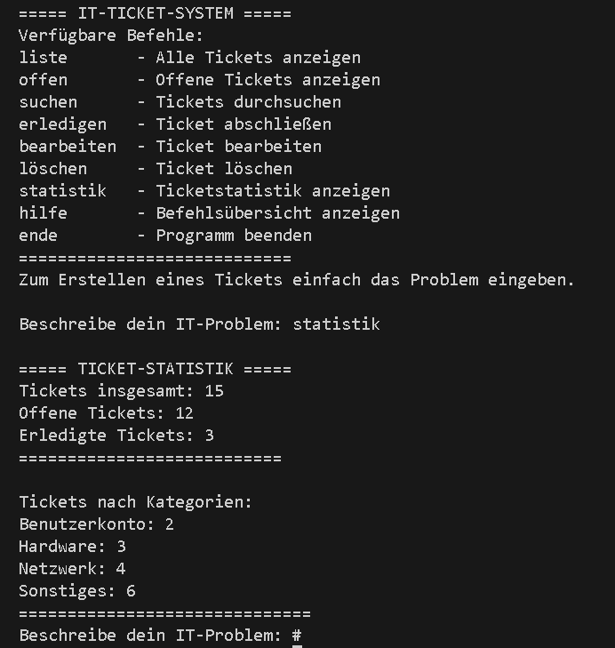

# IT-Ticket-System mit Python und SQLite

Ein konsolenbasiertes IT-Ticket-System, mit dem Supportanfragen erfasst, kategorisiert, verwaltet und dauerhaft in einer lokalen SQLite-Datenbank gespeichert werden können.

## Funktionen

- Tickets erstellen und automatisch kategorisieren
- Alle Tickets oder nur offene Tickets anzeigen
- Tickets anhand ihrer Beschreibung durchsuchen
- Tickets als erledigt markieren
- Problembeschreibung und Kategorie bearbeiten
- Tickets mit Bestätigungsabfrage löschen
- Statistik über Ticketstatus und Kategorien anzeigen
- Daten dauerhaft in SQLite speichern
- Hilfeübersicht mit verfügbaren Befehlen anzeigen

## Screenshot



## Verwendete Technologien

- Python 3
- SQLite (`sqlite3`, Teil der Python-Standardbibliothek)
- SQL: `SELECT`, `INSERT`, `UPDATE`, `DELETE`, `COUNT`, `GROUP BY`

## Voraussetzungen

Python 3 muss installiert sein. Zusätzliche Python-Pakete sind nicht erforderlich.

## Start

1. Repository herunterladen oder klonen.
2. Ein Terminal im Projektordner öffnen.
3. Programm starten:

   ```bash
   python support_sortierer.py
   ```

   Unter manchen Systemen lautet der Befehl `python3 support_sortierer.py`.

Beim ersten Start wird die lokale SQLite-Datenbank `tickets.db` automatisch angelegt.

## Bedienung

| Befehl | Funktion |
| --- | --- |
| Freitext eingeben | Neues Ticket erstellen |
| `liste` | Alle Tickets anzeigen |
| `offen` | Offene Tickets anzeigen |
| `suchen` | Tickets nach Beschreibung durchsuchen |
| `erledigen` | Ticket als erledigt markieren |
| `bearbeiten` | Ticketbeschreibung bearbeiten |
| `löschen` | Ticket mit Bestätigung löschen |
| `statistik` | Ticketstatistik anzeigen |
| `hilfe` | Verfügbare Befehle anzeigen |
| `ende` | Programm beenden |

## Datenhaltung

Die Anwendung speichert Tickets in einer SQLite-Tabelle mit den Spalten `id`, `problem`, `kategorie` und `status`. Die `id` wird von SQLite automatisch vergeben. Beim Programmstart werden vorhandene Tickets geladen; Änderungen werden in der Datenbank gespeichert.

Die Datei `tickets.db` wird **nicht** in Git eingecheckt, damit lokale Testdaten privat bleiben.

## Projektziel

Dieses Lernprojekt wurde entwickelt, um grundlegende Python-Konzepte, den Umgang mit Funktionen und Datenstrukturen sowie die Integration einer SQL-Datenbank praktisch zu üben.

## Mögliche Erweiterungen

- Automatisierte Tests
- Erstellungsdatum und Priorität je Ticket
- Export als CSV
- Grafische Oberfläche oder Weboberfläche
